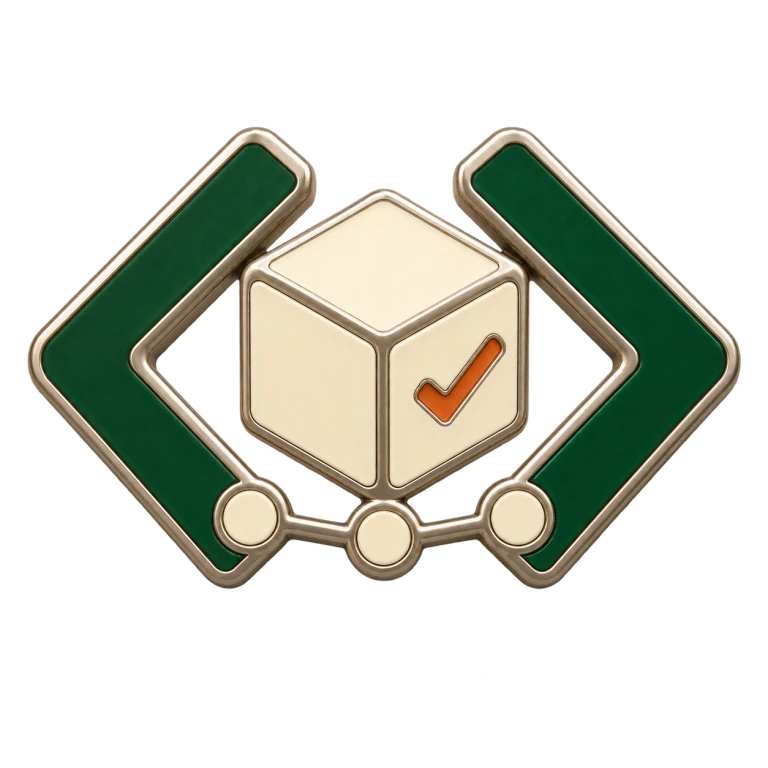
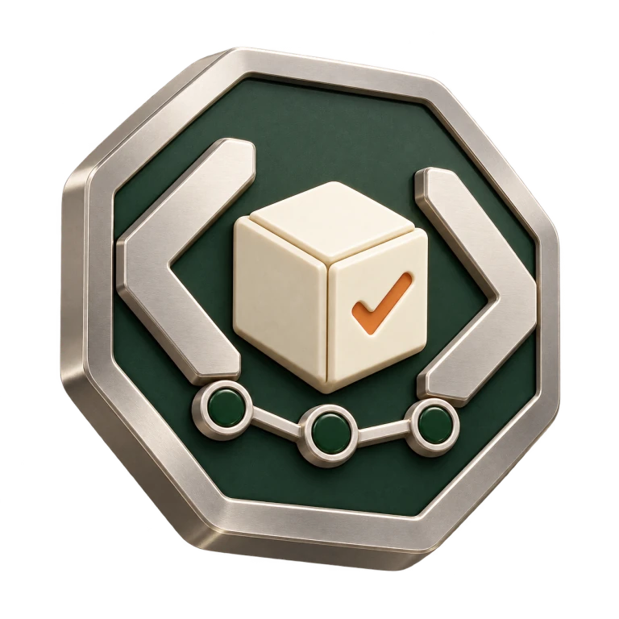

# 代码造物：奖章图形探索

## 核心含义

用「代码经过 AI 协作，形成可用作品」串起 coding、AI、产出和价值。以一个完整构图表达这个过程，避免把四个不相关的图标贴在奖牌上。

| 维度 | 图形语言 | 作用 |
| --- | --- | --- |
| Coding | 开放式代码括号 | 构成奖章的支撑结构和主要轮廓 |
| AI | 相互连接的节点 | 表达连接、计算和协作，融入下部结构 |
| 产出 | 中央成型构件 | 表达从过程形成一个实际作品 |
| 价值 | 作品上的小型完成标记 | 表达可交付、可使用；不等同于收入或估值 |

上述含义是视觉设计寓意。正式成就条件必须来自可验证数据；当前 Token 和上传记录不能证明交付了多少项目、创造了多少经济价值。

## 两种风格

### 珐琅构件（推荐）



代码括号、节点桥和作品形成独立的镂空轮廓，无外圈奖牌底座。薄金属边、深绿珐琅、象牙色构件和少量橙色完成标记，适合现有白底小程序。相比工业浮雕，轮廓更轻，缩小时仍保留代码和作品主体。

### 工业浮雕



薄八边形金属底座，浅浮雕和精密倒角。更接近实物纪念章，但视觉重量仍偏大，保留用于方向比较。

## 使用与验证

- 两图均为 768 × 768 WebP，带真实透明通道；大图约 300 CSS 像素、列表约 96 CSS 像素。
- 已在白底预览中检查大图与 96 像素实际显示，不用 T 字稿替代新版。
- 图片不包含数字、昵称、生产记录或凭证；标题、阈值、日期由界面绘制。
- 尚未注册小程序页面、发放成就或修改生产数据。这是可比较的图形探索，不代表功能上线。
- 后续等级应沿同一构图做细节变化，不能用昂贵装饰替代语义；不再采用皇冠、宝石、月桂和夸张光效。

## 生成方式和提示词

使用内置 `image_gen` 新生成，两种方向分别调用，`transparent_background=true`；没有延用 T 字奖章作为参考。以下是提示词规格，原始 PNG 不放进公开仓库。

共同提示词：

> Create one original achievement badge concept for TokenRank, a WeChat mini-program for people who build things with AI coding tools. Communicate a coherent process: code plus AI collaboration leads to a finished useful artifact. A pair of open angular code brackets forms the supporting sides; three connected circuit nodes form a short bridge; a solid opaque ivory modular cube emerges in the middle as a tangible finished work; a very small inset completion check signifies useful completion. Read as one compact constructed object, not four separate icons. Clear at 96 px. Restrained forest green, warm ivory and a little muted orange. One object centered on transparent alpha, soft studio lighting. No T, letters, numbers, currency, diamonds, crowns, laurel, wings, starbursts, brain, robot, gemstone, background effects, floor or pedestal.

工业浮雕补充：

> Contemporary industrial bas-relief commemorative badge. Thin softly rounded octagonal satin titanium backing, fine machined edge, architectural shallow sculpting, small steps and crisp cutouts. Satin silver code brackets, dark forest-green enamel recess for three connected nodes, opaque warm ivory ceramic central cube and muted orange completion check. Calm crafted-tool quality, no military heraldry or game loot. Subtle 8-degree turn.

珐琅构件补充：

> Refined contemporary soft-enamel collectible pin, with no surrounding coin, disc or shield. The integrated code brackets, node bridge and modular cube are the entire cutout silhouette, with a thin satin nickel rim. Broad forest-green enamel bracket arms; warm ivory planes form the work cube; three small ivory nodes joined by an engraved nickel line in the lower bridge; tiny muted orange completion check inset in the cube face. Low 3D relief and clean layered planes. Strong negative space between brackets and cube. No toy, plastic or candy appearance.

资源打包仅调整尺寸和格式，保留透明背景：

```sh
cwebp -q 90 -alpha_q 100 -m 6 -resize 768 768 source.png -o concept.webp
```

校验值和生成方式记录在 [manifest.json](manifest.json)。
